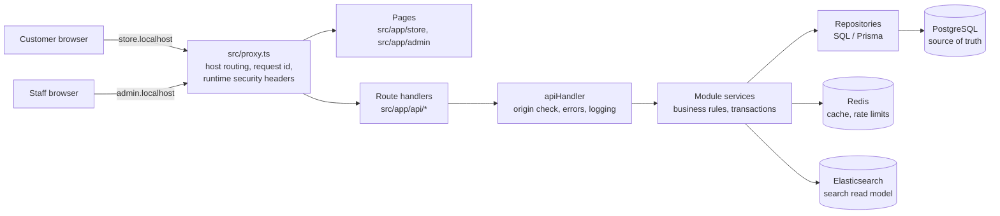

# Architecture

Status (2026-11-14): Waves 1–5 are built and committed. Waves 6–10 (storefront, cart and pricing,
checkout with COD and a simulated online gateway, fulfilment and courier, customers, reports and audit) are
built in the working tree and awaiting owner review (TD-023 to TD-026). Business modules live in
`src/modules/<name>/` as `*.service.ts` (transactions, rules) over `*.repository.ts` (Prisma only); route
handlers in `src/app/api/` stay thin.

## Big picture



- **One codebase, two sites.** `src/proxy.ts` reads the `Host` header, matches it against the hosts in the
  runtime config, and rewrites store pages to `/store/*` and admin pages to `/admin/*`. APIs live under
  `/api/store/*` and `/api/admin/*`; calling the other site's APIs returns 404.
- **PostgreSQL is the source of truth** for everything that matters. Redis and Elasticsearch hold copies
  or counters that can be lost (see `docs/redis-design.md`).
- **Layering inside a module** (from Wave 2B): route handler → service → repository. Route handlers only
  authenticate, validate and call one service. Business rules live in services; SQL lives in repositories.

- **Inventory (`src/modules/inventory/`, TD-018, TD-019, TD-022).** Warehouses, staff stock changes
  (idempotent adjustments and receipts), low-stock thresholds, internal reservation, release, dispatch and
  restock functions for checkout, shipment and returns code, and read-only queries (stock matrix, low stock, ledger, availability). Every stock change
  runs in one transaction that also writes its ledger movement, audit row and search update; row locks
  follow one global hierarchy (orders, shipments, change requests, products, variants, warehouses, stock
  rows), checked at runtime by a per-transaction lock-order tracker.

## Request lifecycle (today)

1. `src/proxy.ts`: decide store/admin/404 from the host; assign `x-request-id`; set `x-surface`; add the
   Content-Security-Policy (and HSTS for HTTPS origins).
2. `next.config.ts` headers: add `nosniff`, `Referrer-Policy`, `X-Frame-Options`, `Permissions-Policy`.
3. Route handler wrapped in `apiHandler` (`src/lib/api-handler.ts`): marks the route dynamic, creates a
   request logger with the request id, rejects state-changing requests from another origin (403), runs
   the handler, maps errors to the standard envelope `{ error: { code, message, details } }`, logs
   duration.
4. Example: `GET /api/health` probes Postgres, Elasticsearch and Redis, each with a time limit, and
   applies the approved health rule.

## Configuration

See TD-002 in `docs/TECHNICAL_DECISIONS.md`.

```
APP_ENV=staging ──► config/config.staging.json ──┐
APP_CONFIG_PATH (optional override) ─────────────┼─► Zod validation at server start ─► getConfig()
.env / platform env: DATABASE_URL, REDIS_URL, ... ┘        (exit code 1 if invalid)
```

## Infrastructure (local)

| Service       | Image                       | Host port        | Notes                                                           |
| ------------- | --------------------------- | ---------------- | --------------------------------------------------------------- |
| PostgreSQL    | `postgres:18.6`             | `127.0.0.1:5433` | source of truth; `ecommerce` (dev) and `ecommerce_test` (tests) |
| Elasticsearch | `elasticsearch:9.5.5`       | `127.0.0.1:9200` | search read model (used from Wave 6)                            |
| Redis         | `redis:8.10.3@sha256:1f88…` | `127.0.0.1:6379` | cache and rate limits; no persistence; 128 MB, `volatile-lru`   |

- **Storefront and search (`src/modules/search`, `src/modules/storefront`, Wave 6).** Elasticsearch
  `products_v<n>` behind the alias, fed by the PostgreSQL outbox after each response (`after()`) and by
  `npm run search:sync`; any Elasticsearch failure falls back to a PostgreSQL search for 5 seconds. The
  category tree, product pages and attribute labels are `'use cache: remote'` entries in Redis, expired by
  tag after each committed change (fail open to PostgreSQL).
- **Cart and pricing (`src/modules/cart`, `src/modules/pricing`, Wave 7, TD-023).** Saved cart per
  customer, guest cart in an httpOnly cookie merged on sign-in. Pure pricing functions (GST-inclusive tax
  component per line, proportional coupon allocation, free-shipping threshold after the coupon, COD fee
  for COD only) in integer paise. Coupons and store settings with audit.
- **Ordering and payment (`src/modules/ordering`, `src/modules/payment`, Waves 8–9, TD-024, TD-025).**
  Checkout runs in one transaction in the TD-019 lock order: cart row → (coupon guarded increment) → order
  insert (`ON CONFLICT` on the idempotency key) → shipments → stock reservation. Order and shipment state
  machines are typed tables with guarded `UPDATE … WHERE status = <from>`; the order status is recomputed
  from its shipments in the same transaction, together with the COD payment rules. The simulated online
  gateway records one attempt per `Idempotency-Key`, at most one success per payment.
- **Fulfilment (`src/modules/fulfilment`, Wave 9).** `CourierProvider` interface with the `demo_courier`
  adapter (deterministic AWB, PDF label, HMAC-signed webhooks); courier calls never run inside a
  transaction (AWB_PENDING first). Webhooks are deduplicated by `(courier, event id)`.
- **Reporting and audit (`src/modules/reporting`, `src/modules/audit`, Wave 10, TD-026).** Aggregate SQL
  over indexed date ranges in IST; reconciliation compares the daily report total, the order rows and
  the payment rows. The audit trail pages by uuidv7 id (time-ordered) on the primary key.

## Order flow

```mermaid
sequenceDiagram
  participant Customer
  participant Store as Store API
  participant DB as PostgreSQL
  participant Staff
  participant Courier as demo_courier
  Customer->>Store: POST /api/store/checkout (Idempotency-Key)
  Store->>DB: one transaction: lock cart, re-price, allocate, insert order + shipments + payment, reserve stock, empty cart
  Customer->>Store: POST /orders/:id/payments (online only)
  Staff->>DB: confirm, pack
  Staff->>DB: AWB_PENDING (commit)
  Staff->>Courier: create shipment (outside any transaction)
  Courier-->>DB: READY_TO_SHIP + AWB
  Courier->>Store: signed webhooks (shipped, out for delivery, delivered)
  Store->>DB: dispatch stock on SHIPPED; COD COLLECTED on DELIVERED; RTO restocks and fails COD
```

## Folder map

```
config/                 runtime configuration per environment (non-secret)
prisma/                 schema, migrations, seed
src/app/                pages (store, admin), API routes, global 404
src/lib/                cross-cutting: config, env, db, redis, elasticsearch, logger, errors,
                        api-handler, health, rate-limit/, security-headers, request-origin, money, ids
src/components/         atoms, molecules, organisms, layouts (atomic design)
src/theme/              theme provider and status colours
tests/support/          shared test helpers (target guard, test app URLs, test database setup)
tests/integration/      Vitest against real Postgres and Redis (test database only)
tests/http/             Supertest against a running app
e2e/                    Playwright browser tests
scripts/                test server, search sync/reindex, unpaid-order expiry
docs/                   design documents, walkthroughs, evidence
```
